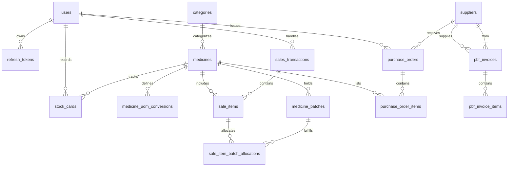

# Raddina Health Service (RHS) Knowledge Base

Welcome to the documentation index for **Raddina Health Service (RHS)**, an integrated pharmacy operations platform. The system combines a high-speed point-of-sale station with **First-Expired, First-Out (FEFO)** batch allocation, pharmacist license verification (SIPA), **Pareto ABC (80/20)** sales analytics, automated **Defekta** inventory reordering, and a 3D WebGL dosage inspector.

> [!tip] Quick Navigation
> - System Architecture Canvas: [[architecture.canvas|System Architecture Map (JSON Canvas)]]
> - Module Status Database: [[modules.base|Subsystem Status Base]]
> - Complete System Overview: [APP_OVERVIEW.md](APP_OVERVIEW.md)
> - REST API Specification: [API_spec.md](API_spec.md)
> - Database Entity-Relationship Diagram: [ERD.mmd](ERD.mmd)

---

## 1. Map of Content (Subsystem Modules)

The system documentation is organized into focused subsystem modules:

| Code | Subsystem Topic | Stack and Layer | Related Note |
| :---: | :--- | :--- | :--- |
| **MOD-01** | **Authentication, RBAC, and SIPA License Enforcement** | NestJS, Argon2, JWT, Drizzle ORM | [[auth-rbac-sipa]] |
| **MOD-02** | **Medicine Catalog, Multi-UOM Conversions, and File Uploads** | Multi-UOM Hierarchy, File Signature Pipe | [[catalog-multi-uom]] |
| **MOD-03** | **Supplier Invoices and Append-Only Stock Cards** | ACID Transactions, Immutable Audit Ledger | [[pbf-invoices-stockcards]] |
| **MOD-04** | **POS Cashier Station, FEFO Allocation, and Web Audio** | Row Locking `FOR UPDATE`, 0ms Audio Feedback | [[sales-pos-fefo]] |
| **MOD-05** | **Pareto ABC Analytics, Defekta, and Electronic Purchase Orders** | Pareto 80/20 Engine, ROP, Nodemailer SMTP | [[pareto-defekta-spel]] |
| **MOD-06** | **3D WebGL Dosage Inspector and Procedural Materials** | Three.js WebGL, PBR Shaders | [[threejs-bio-intelligence]] |
| **MOD-07** | **Design System, Freshness Palette, and Layout Rules** | Tailwind CSS v4, Tabular Numbers | [[design-system]] |

---

## 2. Subsystem Module Database

The status of each system module is tracked through the Obsidian Base view:

![[modules.base]]

---

## 3. Entity-Relationship Overview

The PostgreSQL 17 relational database consists of 12 indexed tables with foreign key constraints:

> [!note] Full Schema Definition
> For complete column types, indexes, and constraints, see [ERD.mmd](ERD.mmd) and `backend/src/db/schema.ts`.

---

## 4. Application Programming Interface (REST API v1)

The backend provides authenticated REST endpoints organized into functional route groups:
- **Authentication and Users**: Registration, login, token refresh, logout, profile inquiry, and owner role assignment.
- **Catalog and Reference Data**: Medicine categories, multi-UOM medicine catalog, distributor directory, and packaging photo uploads.
- **Inventory and Procurement**: Supplier invoice intake, invoice scan uploads, FEFO batch inspection, and stock card audit trails.
- **POS Cashier Operations**: FEFO preview calculation, atomic multi-batch checkout, and receipt inquiries.
- **Analytics and Purchase Orders**: Pareto ABC revenue classification, Defekta reorder calculations, SIPA-validated purchase orders, and near-expiry email alerts.

For request and response schemas, see [API_spec.md](API_spec.md).
